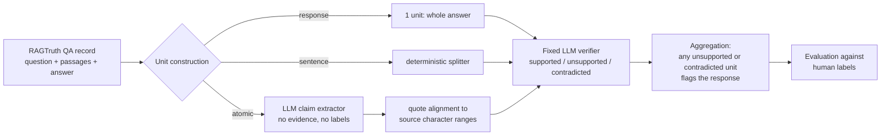

# Verification Granularity for Hallucination Detection in Retrieval-Augmented Generation

**A controlled comparison of response-level, sentence-level and atomic-claim verification on RAGTruth QA**

CSCI 6806 Capstone · Fairleigh Dickinson University, Vancouver Campus · Fall 2026
Group 9: Akrama Mohammed, Hong Quan Pham, Siddhant Bhamri, Lin Cong

---

## Abstract

Retrieval-augmented generation (RAG) supplies source passages to a language model, yet the generated answer can still mix supported statements with an unsupported or contradicted detail. A single verdict for a whole answer says little about *where* the error is, whereas verifying smaller units may expose it at the price of more verifier calls and more opportunities for false alarms. We ask whether verifying **atomic factual claims** improves hallucination detection and error localization enough to justify its processing cost.

We hold the evidence, the verifier (`gpt-5.4-mini-2026-03-17`), the verification prompt and the aggregation rule fixed, and vary only the verification unit: the complete response, each sentence, or each extracted atomic claim. The comparison is run on 300 held-out RAGTruth QA responses (55 human-labelled positives, 138 source clusters), after a frozen protocol and a separate 60-response pilot.

**Main findings.** (i) Response-level verification attains the highest detection F1 (53.6%). Atomic verification is lower by 8.46 points (paired 95% CI [-15.33, -1.04]); the sentence-versus-response difference (-3.11 points, CI [-9.93, 4.40]) is not distinguishable from zero. (ii) Finer units buy recall (74.5% → 94.5% sentence, 92.7% atomic) and localization (character F1 16.6% → 29.3% sentence, 30.2% atomic), but cost precision: atomic checking recovers 10 more positives than response checking while adding 63 false positives. (iii) Atomic verification is roughly 10.9× as expensive as response-level checking and about 10× slower at the median. The best granularity therefore depends on the evaluation goal; in this setting atomic claims did not dominate.

---

## Table of contents

1. [Research question and contributions](#1-research-question-and-contributions)
2. [Background and related work](#2-background-and-related-work)
3. [Experimental design](#3-experimental-design)
4. [Results](#4-results)
5. [Error analysis](#5-error-analysis)
6. [Threats to validity and limitations](#6-threats-to-validity-and-limitations)
7. [Reproducing the study](#7-reproducing-the-study)
8. [Repository layout](#8-repository-layout)
9. [Team contributions](#9-team-contributions)
10. [References](#10-references)

---

## 1. Research question and contributions

**RQ.** Does verifying atomic factual claims improve hallucination detection and error localization over coarser units, and is the improvement worth the additional processing cost?

Illustration of why the unit matters. Given the evidence *"The Eiffel Tower is in Paris. It was completed in 1889 and is approximately 330 metres tall."* and the answer *"… completed in 1887 …"*, a response-level check returns one verdict for everything, a sentence-level check isolates the second sentence, and an atomic check isolates only the completion year while confirming the location and height.

| Granularity | Unit | Typical strength | Typical risk |
|---|---|---|---|
| Response | the complete answer | cheapest; one call | no localization; a long answer may hide a small error |
| Sentence | each sentence of the answer | cheap localization | sentences can bundle supported and unsupported facts |
| Atomic claim | one standalone factual assertion | finest localization | extraction can alter meaning; more units mean more chances to flag a clean answer |

**Contributions.**

- A controlled, three-arm ablation in which *only* the verification unit varies. Evidence, verifier snapshot, verification prompt, output schema and aggregation rule are identical.
- A pre-registered protocol (`protocol_v4c.json`) that freezes the sample, code, prompts, model settings and label policy, with hash checks that make a final run refuse to proceed on drifted artifacts.
- A joint report of detection quality (precision, recall, F1, accuracy), a character-level localization measure, and *full* processing cost (requests, tokens, USD, latency), with paired source-cluster bootstrap intervals.
- An auditable pipeline: every request, raw model output, usage record and prediction is retained and resumable.

This is a controlled implementation study. It does **not** claim novelty for claim decomposition, and it does not reproduce the RefChecker triplet benchmark or published MiniCheck/RAGChecker numbers.

---

## 2. Background and related work

| Work | What it provides | Role here |
|---|---|---|
| RAGTruth [1] | RAG responses with human-annotated hallucination spans | Dataset and gold labels |
| RefChecker [2] | Claim-triplet extraction and reference-based checking; already compares verification granularities | Decomposition reference |
| MiniCheck [3] | Efficient claim verification against grounding documents with small models | Efficiency motivation; *not* the verifier used here |
| RAGChecker [4] | Fine-grained diagnostics for retrieval and generation | Evaluation context; retrieval is held fixed here |

RefChecker already shows that granularity matters. Our narrower contribution is to isolate verification granularity for **natural-language claim decomposition** on a fixed RAGTruth QA sample, under **one** general-purpose LLM verifier and **one** aggregation rule, and to report detection, localization and cost together. Because retrieval is fixed, the study cannot rank retrievers or explain retrieval failures; because the answers pre-exist in the dataset, it evaluates faithfulness to the supplied passages, not answer quality against a reference.

---

## 3. Experimental design

### 3.1 Pipeline



Human labels are used **only** for evaluation. A field whitelist guarantees that `labels`, `meta` and gold offsets never enter any prompt.

### 3.2 Data and sampling

- **Source.** Official RAGTruth [1], QA task only, `quality = good` records only, pinned at commit `c103204b9ce28d6bbad859304bf30de72b8ed8fe` (`source_info.jsonl`, `response.jsonl`; SHA-256 values in `REFERENCES.md`). Original response text and annotation offsets are preserved; nothing is re-retrieved or regenerated.
- **Pilot.** 60 responses sampled uniformly without replacement from the official **train** split.
- **Evaluation.** 300 responses sampled uniformly without replacement from the official **test** split: **138 source groups, 55 gold-positive and 245 gold-negative responses**.
- **Controls.** Sampling is label-agnostic (no forced class balance) with seed `20261015`. Pilot and evaluation `source_id`s do not overlap. The code refuses to run pilot or smoke data from the test split and the final run on train data.
- **Gold policy.** A response is positive if it carries at least one annotated span. The primary policy includes `implicit_true` annotations because the task is strict support by the provided evidence; a predeclared sensitivity analysis excludes them.

### 3.3 Verification units

- **Response.** The original answer is verified once.
- **Sentence.** A deterministic punctuation and newline splitter that preserves character offsets and attaches list numbers and passage citations to their sentences.
- **Atomic claim.** A structured-output extraction call receives the question and the response (never the evidence or labels) and returns independently checkable assertions that retain values, negation, uncertainty, scope and attribution. Each claim carries a sentence ID and **exact, contiguous quoted fragments** that are mapped back to character ranges. If a quote cannot be aligned, the claim is still verified but is localized with its whole sentence (`sentence_fallback`); an empty extraction falls back to sentence verification (`empty_extraction_sentence_fallback`), so an extraction failure can never silently become a "clean" prediction. Exceeding `max_claims` (80) is an error, not a truncation.

### 3.4 Verifier, prompt and aggregation

All three arms use `gpt-5.4-mini-2026-03-17` [6] with the same verification prompt and JSON schema. Each call receives the question, the evidence, the response as untrusted context for pronoun resolution, and the target unit, and returns one of `supported`, `unsupported` or `contradicted` with a reason. **Any** unsupported or contradicted unit makes the response positive. The program never exits early, so localization is complete and the cost comparison is not distorted by an early-stopping rule.

| Setting | Value |
|---|---|
| Verification reasoning effort / output limit | `none` / 1,024 tokens |
| Extraction reasoning effort / output limit | `low` / 8,192 tokens |
| Temperature | omitted |
| Inputs exceeding frozen length limits | run stops; no truncation |
| Execution order | reproducibly shuffled (`repeat = 1`) |
| Transport | OpenAI Chat Completions via `curl`; Python standard library only |

### 3.5 Atomic extraction rules (v4c)

The extraction prompt was developed on pilot-split data and then frozen. The final revision (v4c) enforces:

1. **Alternatives stay together.** "Heat for 2-3 minutes *or until* it reaches 165 °F" remains one claim; a choice is never split into two obligations.
2. **Scope of exclusivity words.** "X provides *only* A and B" is one claim, not "only A" plus "only B". A modifier is copied onto each coordinated item only when the source clearly applies it to each.
3. **Quantities and enumerations.** Independent quantities ("14 vitamins and 15 minerals") become separate claims with the original numbers; explicit member lists are extracted item by item. Ranges, inseparable relations and necessary conditions stay intact.
4. **Contiguous quotes.** Every quote is one unedited substring of its source sentence; discontinuous wording uses several quote objects.

### 3.6 Metrics

With TP, FP, FN, TN counted at the response level: precision = TP/(TP+FP), recall = TP/(TP+FN), F1 = 2TP/(2TP+FP+FN), accuracy = (TP+TN)/300. Accuracy alone is misleading here: an always-clean detector would score 81.67% (245/300) with zero recall and F1.

**Character F1** is a project localization metric: the micro-F1 of the character overlap between the *union* of flagged source ranges and the union of gold ranges within each response. A flagged response marks the whole response, a flagged sentence marks the whole sentence, and an atomic claim marks its quoted ranges. It therefore reflects unit size and alignment quality and is **not** the official word-level RAGTruth score, nor a measure of claim factual accuracy.

**Uncertainty.** 95% intervals come from 1,000 **paired source-cluster bootstrap** resamples of the 138 source groups (seed `20261015`); the three variants remain paired within each resample. Intervals describe sampling uncertainty, not run-to-run variation of a stochastic verifier or extractor.

### 3.7 Protocol freeze

`protocol_v4c.json` (SHA-256 `276d6df0361608c429e9d7f72eff506a732fc7aba53793bb38acc3add24d2317`) fixes the sample, code hash, prompt hashes, model configuration, label policy and the pilot `source_id`s. The final run verifies these hashes before issuing any request, and its manifest records the same protocol hash. Pilot results were not reused in the final run.

---

## 4. Results

All results below are from the completed formal run `runs/final_v4c_r1` (300 / 300 paired responses, 900 predictions, `paired_complete_n = 300`).

### 4.1 Detection and localization

| Variant | Precision | Recall | Detection F1 | Accuracy | Char. F1 | TP / FP / FN / TN |
|---|---:|---:|---:|---:|---:|:---:|
| Response | **41.84** | 74.55 | **53.59** | **76.33** | 16.61 | 41 / 57 / 14 / 188 |
| Sentence | 34.44 | **94.55** | 50.49 | 66.00 | 29.30 | 52 / 99 / 3 / 146 |
| Atomic claim | 29.82 | 92.73 | 45.13 | 58.67 | **30.23** | 51 / 120 / 4 / 125 |

All scores are percentages. Detection F1 95% intervals (cluster bootstrap): response [43.5, 62.3], sentence [41.4, 58.6], atomic [37.0, 53.2].

Character-level precision and recall, which decompose the localization gain:

| Variant | Char. precision | Char. recall | Char. F1 |
|---|---:|---:|---:|
| Response | 9.23 | 83.33 | 16.61 |
| Sentence | 17.70 | 84.89 | 29.30 |
| Atomic claim | 19.22 | 70.74 | 30.23 |

**Paired differences in detection F1 (versus response).**

| Comparison | Δ F1 (points) | Paired 95% CI | Interpretation |
|---|---:|:---:|---|
| Sentence − response | −3.11 | [−9.93, +4.40] | not distinguishable from zero |
| Atomic − response | −8.46 | [−15.33, −1.04] | supports lower atomic F1 in this setting |

**Reading the table.**

- *Recall versus precision.* Sentence and atomic verification catch 52 and 51 of the 55 positives versus 41 for the response-level check, but they also produce 99 and 120 false positives versus 57. Specificity (derived, TN/245) falls from 76.7% (response) to 59.6% (sentence) and 51.0% (atomic). Under the any-flag rule, every additional unit is another chance to flag a clean answer, so false positives grow with the number of units.
- *Localization.* Both fine-grained arms nearly double the character F1 of response-level checking (+12.7 and +13.6 points). Atomic checking exceeds sentence checking by only 0.93 points; no paired interval was computed for this difference, so **we do not claim a reliable localization advantage of atomic claims over sentences.** Atomic localization is more precise (19.2% vs 17.7%) but loses character recall (70.7% vs 84.9%), consistent with claims that omit or cannot be aligned to parts of the annotated spans.
- *Sensitivity analysis.* Excluding `implicit_true` annotations leaves 42 positives; detection F1 becomes 44.29% (response), 40.41% (sentence) and 35.68% (atomic). The absolute values drop but the ordering is unchanged.

### 4.2 Processing cost and latency

| Variant | Mean units / response | Mean API calls / response | Median s / response | Mean s / response | Prompt / completion tokens | Cost, 300 responses (USD) |
|---|---:|---:|---:|---:|---:|---:|
| Response | 1.00 | 1.00 | 1.27 | 1.34 | 249,839 / 27,164 | 0.310 |
| Sentence | 6.48 | 6.48 | 6.25 | 58.24 | 1,472,572 / 109,990 | 1.599 |
| Atomic claim | 9.45 | 10.46 | 12.87 | 44.46 | 3,042,585 / 343,789 | 3.378 |

- **Estimated total cost** for the three variants on 300 responses: **USD 5.287**, computed from recorded token usage and frozen per-token prices (`config.json`, checked 2026-10-15). These are usage-based estimates, not invoices.
- **Atomic versus response:** 10.91× the cost and about 10× the median latency; sentence is 5.2× the cost and about 4.9× the median latency.
- **Mean latencies are distorted by two extreme timeout waits** (15,238.64 s and 9,052.38 s), both of which succeeded on retry; the cause is unknown. **Medians are the primary timing comparison.** Latency is client-observed end-to-end time (network and service load included).
- **Request accounting.** Atomic checking adds one extraction call per response, and its mean API calls include extraction and retries. The run produced 5,380 successful raw outputs (300 response + 1,944 sentence + 2,836 atomic verifications + 300 extractions). One successful extraction is absent from `calls.jsonl`; its raw output, request and prediction are preserved and its cost is included.

### 4.3 Extraction quality

Of 2,836 atomic units, **108 (3.81%)** required sentence-alignment fallback; the other 2,728 were aligned to exact quoted ranges. Exact string alignment shows only that the cited text was found, not that a claim is semantically faithful, atomic, or complete.

### 4.4 Pilot (development stage only)

On the 60 train-split pilot responses (17 positives), with the v4c extractor, detection F1 was 66.7% (response), 65.2% (sentence) and 64.0% (atomic), with recall 82.4%, 88.2% and 94.1%. The three F1 intervals overlap almost completely. The pilot reused cached response and sentence calls from an earlier exact-matching run, so its latencies are historical and not a fresh three-arm timing comparison; only the atomic arm was re-run. The pilot informed prompt development and is **not** evidence for the final conclusions.

---

## 5. Error analysis

Two cases from the formal run illustrate how extraction interacts with verification (qualitative, AI-assisted inspections; independent human audits of claim fidelity are not completed, and benchmark labels are unchanged):

- **False positive from scope strengthening (response 12905).** The original answer says the passages *"primarily focus on how to cook and peel hard-boiled eggs."* The extractor produced *"…primarily focus on how to peel hard-boiled eggs."* Splitting the shared description "cook and peel" strengthened the claim about peeling, the verifier judged it unsupported, and a clean response (gold: no hallucination) was flagged.
- **Miss from dropped attribution (response 12435).** Extraction omitted an incorrect passage attribution present in the original sentence, so the erroneous attribution was never verified, causing a false negative.

Recurring extraction problems observed during development and the pilot:

- **Framing statements quoted from another sentence.** A lead-in such as "To change your age on IMVU, follow these steps:" is cited as a quote for step sentences. The quote does not lie inside the claim's own sentence, so the claim falls back to whole-sentence localization (concentrated in a few list-style responses).
- **Weakened or strengthened modifiers**, for example dropping "easily", or restating "main symptoms" as "can cause".
- **Lost heading context** (e.g. a "Microwaving:" heading omitted from the claim text), and **imperative-to-declarative rewrites** that subtly change modality.
- **Enumeration blow-up.** Splitting a long list into one claim per member raises unit counts (one response yielded 34 claims in a diagnostic run, 40 in the pilot), cost and latency, and is bounded by `max_claims = 80`.
- **Stochastic extraction.** Identical prompts and inputs yield different claim sets across runs (mean Jaccard overlap about 0.35 on a hard diagnostic subset), so single-run atomic results contain extraction noise.

`claim_audit.csv` and `response_audit.csv` in the result directory are structured forms for the planned manual audit; `errors.csv` lists every false positive and false negative per variant.

---

## 6. Threats to validity and limitations

- **Single verifier, single run per variant, single QA sample (300 responses).** Results may not generalize to other verifiers (e.g. MiniCheck-class models), tasks (summarization, data-to-text), or datasets. Bootstrap intervals cover sampling uncertainty only, not stochastic variation across repeated runs.
- **Small positive class.** Only 55 gold positives (42 without `implicit_true`); recall and precision estimates for each arm therefore have wide uncertainty.
- **Confounded arms.** Atomic verification differs from the others in more than the unit: it also uses a separate extraction step at `low` reasoning effort with a long, hand-designed prompt whose examples were developed on pilot-split data. The verification stage itself is identical across arms.
- **Aggregation rule.** The any-flag rule is deliberately simple and mechanically favors recall as units multiply. Other aggregations (thresholds on the number or severity of flagged units) were not explored.
- **Localization metric.** Character F1 is a custom measure sensitive to unit size and alignment (fallback units inherit sentence ranges); it is not the official RAGTruth word-level metric. No paired interval was computed for the atomic-versus-sentence localization difference.
- **Label policy.** Primary labels include `implicit_true` annotations (information plausibly true but not stated in the evidence). This is a deliberate strict-support choice; the sensitivity analysis shows the ordering is robust to it.
- **Timing.** Latency includes network and service load. Two extreme timeouts inflate the means, and one extraction ledger entry is missing from the call log (raw data preserved). Only one timing run exists.
- **Cost.** Costs use configured token prices and may differ from billing.
- **Claim fidelity.** Faithfulness of extracted claims has not been established by an independent human audit.

**Next steps.** Audit sampled claims for scope, coverage and attribution; define error categories and a separate confirmation protocol (changes will use development data, with the frozen test results retained); repeat timing and check request-log completeness; and examine meaning-preserving decomposition and citation preservation.

---

## 7. Reproducing the study

**Requirements.** Python 3.10 or newer (the formal run used Python 3.13.1), `curl` on the `PATH`, and an OpenAI API key with access to `gpt-5.4-mini-2026-03-17`. There are **no pip dependencies** (standard library only) and no GPU requirement. The commands below use Windows PowerShell; on macOS or Linux substitute `python3` for `py -3`.

### 7.1 Offline checks (no API cost)

```powershell
py -3 experiment.py doctor                 # prints model name and whether a key is present (never the key)
py -3 -m unittest discover -s tests -v     # automated tests; make no paid API calls
py -3 experiment.py demo --out runs/demo   # synthetic fixture to inspect report formats
```

`demo` uses a hand-made rule, not a model; its output is labelled `DEMO FIXTURE ONLY NOT RESEARCH RESULTS` and must never be reported as a result.

### 7.2 Configure the API key

Keep the key in an environment variable only; never in code, `config.json`, or chat.

```powershell
$ragKeySecret = Read-Host "Enter your API key" -AsSecureString
$env:OPENAI_API_KEY = [System.Net.NetworkCredential]::new("", $ragKeySecret).Password
py -3 experiment.py doctor
```

### 7.3 Workflow

```powershell
# 1. Inspect workload (no API calls)
py -3 experiment.py plan --input data/pilot60.jsonl

# 2. Smoke test on 3 real train responses, then extrapolate cost
py -3 experiment.py run --input data/smoke3.jsonl --out runs/smoke --phase smoke --max-requests 200 --max-usd 2
py -3 experiment.py evaluate --input data/smoke3.jsonl --run-dir runs/smoke --bootstrap 0
py -3 experiment.py estimate --run-dir runs/smoke --n 300

# 3. Pilot on 60 train responses; audit claims, then iterate in a NEW output directory per code or config change
py -3 experiment.py run --input data/pilot60.jsonl --out runs/pilot --phase pilot --max-requests 6000 --max-usd 5
py -3 experiment.py evaluate --input data/pilot60.jsonl --run-dir runs/pilot --bootstrap 1000

# 4. Freeze the protocol (sample, code, prompts, model, label policy, pilot source_ids)
py -3 experiment.py freeze --pilot-dir runs/pilot --final-data data/final300.jsonl --out protocol.json --audit-notes templates/pilot_audit_notes.md

# 5. Formal run on 300 test responses, then evaluate
py -3 experiment.py run --input data/final300.jsonl --out runs/final_r1 --phase final --lock protocol.json --max-requests 20000 --max-usd 20 --repeat 1
py -3 experiment.py evaluate --input data/final300.jsonl --run-dir runs/final_r1 --bootstrap 1000
```

Notes on behavior:

- **Spending controls.** `--max-requests` is a hard cap on network requests (retries count). `--max-usd` is a soft threshold checked before each call against the cumulative cost recorded in the output directory (the last call may overshoot). On hitting either limit the run stops and keeps all progress; re-run the same command with the same directory to resume. Successful calls are cached per request and never repeated.
- **Never mix configurations.** Any change to code, prompt, model or data requires a new output directory. A directory can be resumed only with an identical fingerprint, and a final run refuses to start if the frozen hashes do not match.
- **Completeness.** `evaluate` requires all three variants for every response. `--allow-partial` is for debugging only and labels the report PARTIAL.
- **Reusing baseline calls.** `atomic_tools.py reuse` copies response/sentence calls from an earlier complete run into a fresh directory *only* when requests match exactly, so that only the atomic arm is re-run. Reports then disclose that those timings and costs are historical.
- **Diagnostics.** `atomic_tools.py check` runs extraction only (at most 10 train responses, empty output directory) to inspect claims before spending on verification.
- **Timing.** For a more reliable latency comparison, repeat the final run in fresh directories (`--repeat 2`, `--repeat 3`) and report all runs.

### 7.4 Rebuilding the samples from the official data

```powershell
py -3 experiment.py download --raw-dir raw_data
py -3 experiment.py prepare --raw-dir raw_data --out reproduced_data --pilot-n 60 --final-n 300 --seed 20261015
```

The download (about 36.6 MB) is checked against the pinned commit and SHA-256 values; the regenerated files must be byte-identical to `data/`.

### 7.5 Outputs of a run directory

| File | Content |
|---|---|
| `metrics.csv` | one row per variant: precision, recall, F1, accuracy, character span metrics, TP/FP/FN/TN, latency, units, requests, fallback units, cost, F1 interval |
| `summary.json` | all metrics, sensitivity analysis, paired bootstrap, `paired_complete_n`, fingerprints |
| `report.md`, `report.html` | human-readable report; the HTML expands each response with per-unit verdicts |
| `predictions.jsonl` | per-response predictions, flagged units and spans |
| `calls.jsonl`, `call_cache/` | request ledger (usage, duration, cost) and raw model outputs |
| `errors.csv` | every false positive and false negative |
| `claim_audit.csv`, `response_audit.csv` | blank manual-review forms for claim fidelity and coverage |
| `run_manifest.json` | configuration, hashes, protocol hash, environment, status |

---

## 8. Repository layout

| Path | Purpose |
|---|---|
| `experiment.py` | command-line entry point (`doctor`, `plan`, `run`, `evaluate`, `estimate`, `freeze`, `download`, `prepare`, `demo`) |
| `atomic_tools.py` | extraction-only diagnostics (`check`) and exact cache reuse (`reuse`) |
| `ragstudy/` | data handling, extraction and verification prompts, API client and transport, engine, scoring and export |
| `config.json` | verifier and extractor settings, limits, price table |
| `data/` | `smoke3`, `pilot60` (train) and `final300` (test) samples, plus `manifest.json` with versions, seed and SHA-256 values |
| `protocol_v4c.json` | frozen protocol used by the formal run |
| `pilot_v4c_review.md` | AI-assisted pilot review (run integrity, metrics, qualitative audit) that preceded the freeze; not a human gold annotation |
| `runs/final_v4c_r1/` | complete formal results (per-call cache excluded from Git) |
| `tests/` | automated tests (no paid API calls) |
| `templates/` | manual-audit and experiment-log templates |
| `TECHNICAL_NOTES.md`, `REFERENCES.md` | experimental design, scoring definitions and sources |
| `licenses/` | RAGTruth license; data in `data/` is derived from the official corpus |
| `apply_*.py`, `*_FIX_NOTES.md` | historical patch scripts and notes from development; not part of the experiment and not to be re-run |

---

## 9. Team contributions

- **Akrama Mohammed**: background, motivation and research objectives.
- **Hong Quan Pham**: review of RAGTruth, RefChecker, MiniCheck and RAGChecker.
- **Siddhant Bhamri**: dataset definition, verification pipeline and ablation design.
- **Lin Cong**: experiment implementation; analysis of results, latency and cost.

---

## 10. References

1. C. Niu, Y. Wu, J. Zhu, S. Xu, K. Shum, R. Zhong, J. Song, T. Zhang. *RAGTruth: A Hallucination Corpus for Developing Trustworthy Retrieval-Augmented Language Models.* ACL 2024, pp. 10862-10878. doi:10.18653/v1/2024.acl-long.585. <https://aclanthology.org/2024.acl-long.585/>
2. X. Hu, D. Ru, L. Qiu, Q. Guo, T. Zhang, Y. Xu, Y. Luo, P. Liu, Y. Zhang, Z. Zhang. *RefChecker: Reference-based Fine-grained Hallucination Checker and Benchmark for Large Language Models.* arXiv:2405.14486, 2024. <https://arxiv.org/abs/2405.14486>
3. L. Tang, P. Laban, G. Durrett. *MiniCheck: Efficient Fact-Checking of LLMs on Grounding Documents.* EMNLP 2024, pp. 8818-8847. doi:10.18653/v1/2024.emnlp-main.499. <https://aclanthology.org/2024.emnlp-main.499/>
4. D. Ru et al. *RAGChecker: A Fine-grained Framework for Diagnosing Retrieval-Augmented Generation.* arXiv:2408.08067, 2024. <https://arxiv.org/abs/2408.08067>
5. ParticleMedia. *RAGTruth* dataset and repository, commit `c103204b9ce28d6bbad859304bf30de72b8ed8fe`. <https://github.com/ParticleMedia/RAGTruth>
6. OpenAI. *Chat* API reference; model `gpt-5.4-mini-2026-03-17`. <https://developers.openai.com/api/reference/resources/chat>
7. Python Software Foundation. *The Python Standard Library*, Python 3.13 documentation. <https://docs.python.org/3.13/library/>

The experiment code, `config.json`, `protocol_v4c.json`, `data/final300.jsonl` and `runs/final_v4c_r1` records in this repository are the course artifact on which all numbers above are based.

## License

The study code is released under the MIT License (see `LICENSE`). Sample data in `data/` is derived from RAGTruth and is subject to its license in `licenses/RAGTruth_LICENSE.txt`.
